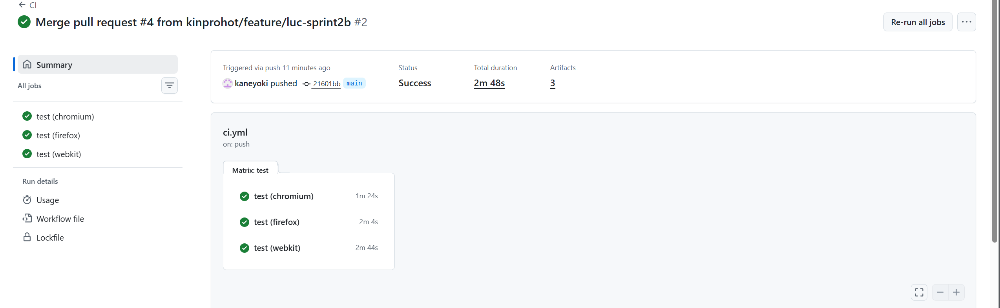
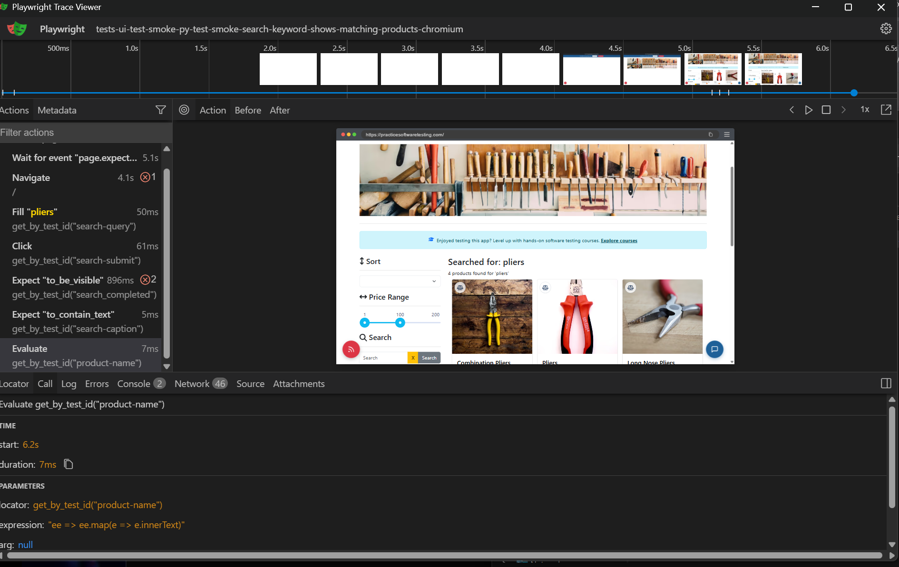

# Toolshop Practice - bài thực hành 4 buổi (Automation Testing)


## Kết quả CI



## Trace Viewer



## Phân công công việc

| Thành viên | Tài khoản GitHub | Nhiệm vụ chính |
|---|---|---|
| Nguyễn Văn Lực | `kinprohot` | Khung kiểm thử POM, Smoke tests, API tests, Network route, BDD, CI/CD (`ci.yml`), Săn lỗi BUGGY & `BUG_REPORT.md` |
| Tín | `kaneyoki` | Review Pull Request, phối hợp kiểm thử smoke & giao diện |

## Bảng Test Case tổng hợp

| ID | Nhóm / Chức năng | Mô tả | Các bước chính | Dữ liệu | Kết quả mong đợi |
|---|---|---|---|---|---|
| TC-UI-01 | Tìm kiếm (`smoke`) | Tìm kiếm theo từ khóa | Mở trang chủ -> nhập `pliers` -> Search | `"pliers"` | Caption chứa `pliers`, mọi tên sản phẩm chứa `pliers` |
| TC-UI-02 | Chi tiết & Giỏ (`smoke`) | Thêm số lượng 3 vào giỏ | Mở `Claw Hammer` -> chọn qty `3` -> Add to cart | `"Claw Hammer"`, `3` | Toast xác nhận, badge giỏ hiện `3` |
| TC-UI-03 | Xác thực (`smoke`) | Đăng nhập sai mật khẩu | Mở Login -> nhập email không tồn tại -> Login | `nobody-exists-sprint1@example.com` | Hiện `Invalid email or password`, giữ nguyên `/auth/login` |
| TC-UI-04 | Liên hệ (`smoke`) | Gửi form liên hệ trống | Mở Contact -> không điền -> Send | Trống | Hiện `Subject is required` và `Message is required` |
| TC-UI-05 | Tìm kiếm | Tìm từ khóa không tồn tại | Mở trang chủ -> tìm `zzz-no-such-tool` | `"zzz-no-such-tool"` | Hiện `There are no products found.`, 0 sản phẩm |
| TC-UI-06 | Sắp xếp | Sắp xếp theo giá tăng/giảm | Mở trang chủ -> chọn `price,asc` / `price,desc` | `price,asc`, `price,desc` | Danh sách giá trên trang được sắp xếp đúng chiều |
| TC-UI-07 | Bộ lọc | Lọc theo danh mục Hammer | Mở trang chủ -> tích checkbox `Hammer` | `"Hammer"` | Mọi sản phẩm hiển thị có chữ `hammer` |
| TC-UI-08 | Giỏ hàng | Tính thành tiền & tổng giỏ | Thêm `Combination Pliers` qty 2 -> vào Cart | `"Combination Pliers"`, `2` | Line total = đơn giá x 2, tổng = tổng các dòng |
| TC-UI-09 | Tài khoản | Tái sử dụng phiên đăng nhập | Mở `/account` bằng `logged_in_page` (`storage_state`) | `auth_state` | Tiêu đề `My account`, menu hiện tên `QA Bot` |
| TC-UI-10 | Liên hệ (AI) | Gửi form liên hệ thiếu Subject | Điền tên, email, message -> bỏ trống Subject -> Send | Thiếu Subject | Hiện chính xác `Subject is required` |
| TC-BDD-01 | Giỏ hàng (BDD) | Scenario Outline tính tiền giỏ | Mở sản phẩm -> thêm số lượng -> vào giỏ | `Combination Pliers (1)`, `Claw Hammer (3)` | Line total = unit price x quantity |
| TC-NET-01 | Route / Mock | Chặn ảnh & giả lập API rỗng | `page.route()` abort ảnh / fulfill `EMPTY_PAGE` | `EMPTY_PAGE` | Trang vẫn chạy khi chặn ảnh; hiện thông báo rỗng khi API rỗng |
| TC-API-01 | API Sản phẩm | Hợp đồng JSON, tìm kiếm JSON, 4xx | `GET /products`, `GET /products/search`, `401/404` | `data/search_keywords.json` | Đúng schema phân trang, mọi tên khớp từ khóa, đúng mã 4xx |
| TC-API-02 | API User & Cart | Validate 422, Bearer token, Giỏ | `POST /users/register`, `GET /users/me`, `POST/GET /carts` | `test_user`, `auth_headers` | 422 khi rỗng, 200 với token, giỏ lưu đúng số lượng |

## Sử dụng AI

| Test | Công cụ | AI viết gì | Sai ở đâu | Em sửa thành | Commit |
|---|---|---|---|---|---|
| `test_contact_without_subject_shows_error` | Gemini / AI Assistant | Sinh test điền form liên hệ thiếu Subject và gọi `submit()` | Thiếu docstring 3 dòng theo luật lớp; assertion lỏng chỉ kiểm `expect(contact.subject_error).to_be_visible()` mà không kiểm nội dung lỗi | Thêm docstring 3 dòng (Goal, Precondition, Expected) và siết thành `expect(contact.subject_error).to_have_text("Subject is required")` | Draft: `ccaaa1b` → Sửa: `a60411e` |

## Báo cáo lỗi trên BUGGY

Xem chi tiết 7 lỗi thật đã phát hiện và xác minh trên môi trường BUGGY kèm ảnh bằng chứng tại: [docs/BUG_REPORT.md](docs/BUG_REPORT.md)

Repo này là "phòng lab" trên lớp. Mỗi buổi có một thư mục bài tập trong `tests/`. Bài nào chưa làm sẽ đỏ (`NotImplementedError`), làm xong thì xanh. Mục tiêu mỗi buổi: biến đỏ thành xanh, đúng luật.

Hệ thống kiểm thử: Toolshop https://practicesoftwaretesting.com (PROD) và https://with-bugs.practicesoftwaretesting.com (BUGGY).

## 1. Cài đặt (làm ở nhà trước buổi 1, khoảng 15 phút)

Cần Python 3.12, Git và một tài khoản GitHub.

**Tạo repo của em từ repo lớp:** mở https://github.com/jameboykks/toolshop-practice, bấm **Use this template**, chọn **Create a new repository**, đặt tên `toolshop-practice`, chọn **Public**. Repo của em có sẵn toàn bộ bài tập và là nơi em đẩy code, chạy CI ở buổi 3. Sau đó clone repo của em về máy:

Windows (PowerShell):

```powershell
git clone https://github.com/<tài-khoản-của-em>/toolshop-practice.git
cd toolshop-practice
py -3.12 -m venv .venv
.venv\Scripts\activate
pip install -r requirements.txt
playwright install chromium
copy .env.example .env
python tools/doctor.py
```

macOS / Linux:

```bash
git clone https://github.com/<tài-khoản-của-em>/toolshop-practice.git
cd toolshop-practice
python3.12 -m venv .venv
source .venv/bin/activate
pip install -r requirements.txt
playwright install chromium
cp .env.example .env
python tools/doctor.py
```

`tools/doctor.py` kiểm Python, thư viện, trình duyệt, tệp `.env`, kết nối tới Toolshop và GitHub, Git và Node.js. Thấy dòng "Máy đã sẵn sàng" là xong. Dòng nào ghi `[LỖI]` thì làm theo gợi ý ngay bên dưới rồi chạy lại.

Chạy thử bộ test mẫu: `pytest tests/buoi1/test_b1_spaghetti.py` phải ra `4 passed`.

Cần cài thêm trước buổi 4: Node.js bản LTS (https://nodejs.org/), dùng cho Playwright MCP.

Nên làm trước buổi 2: tạo token GitHub (github.com, Settings, Developer settings, Fine-grained tokens, Generate, không cần chọn quyền nào) rồi điền vào dòng `GITHUB_TOKEN=` trong `.env`. Không có token, cả lớp dùng chung mạng trường chỉ được gọi GitHub API 60 lần mỗi giờ.

URL của hệ thống nằm trong tệp `.env` (BASE_URL, API_URL, ROUTE_PREFIX), không bao giờ nằm trong code. Biến đặt trong terminal sẽ được ưu tiên hơn `.env`. Tệp `.env` không được commit.

## 2. Lệnh hay dùng

```bash
pytest tests/buoi1                         # chạy cả buổi 1
pytest tests/buoi1 -k b1_3                 # chỉ bài B1.3
pytest tests/buoi1 -k b1_3 --headed --slowmo 300   # xem trình duyệt chạy chậm
pytest -m smoke                            # chỉ test gắn nhãn smoke
pytest -n auto                             # chạy song song
pytest --tracing on -k b1_4                # ghi trace
playwright show-trace test-results/<tên-test>/trace.zip
playwright codegen https://practicesoftwaretesting.com   # tìm locator
```

## 3. Cấu trúc

```
pages/          page object (BasePage có sẵn, các trang khác có TODO)
tests/buoi1/    Page Object Model
tests/buoi2/    API Toolshop, API GitHub, route / mock, API + UI
tests/buoi3/    BDD (pytest-bdd) - features/ + step definitions
tests/buoi4/    assertion lỏng cần siết để bắt lỗi trên BUGGY
clinic/         "phòng khám flaky" - 5 test bệnh cần chẩn đoán
data/           dữ liệu JSON cho test data-driven
bai-doc/        bài đọc ôn tập mỗi buổi (đọc sau buổi học)
docs/           mẫu BUG_REPORT.md
.github/        workflows/ci.yml.todo có chỗ trống (buổi 3, điền xong đổi tên thành ci.yml), mẫu Pull Request
tools/doctor.py kiểm tra máy trước buổi học
toolshop/       Toolshop chạy bằng Docker cho CI (buổi 3): không cần sửa, xem bai-doc buổi 3 mục 4.3
conftest.py     fixture dùng chung: api, github, test_user, auth_token, auth_headers, logged_in_page
```

## 4. Luật chơi (giống đồ án cuối kỳ)

1. Locator chỉ nằm trong `pages/`. Assertion chỉ nằm trong `tests/`.
2. Không `time.sleep()`, không `wait_for_timeout()`. Chờ bằng `expect()` hoặc `expect_response()`.
3. Không assert số lượng tuyệt đối hay id cụ thể: PROD có 50 sản phẩm, BUGGY có 26.
4. Mỗi test có docstring 3 ý: mục tiêu, tiền điều kiện, kết quả mong đợi.
5. Không dùng tài khoản dùng chung (`customer@`, `customer2@`, `admin@`) trong test. Test cần đăng nhập dùng tài khoản riêng do fixture `test_user` tạo. Test đăng nhập sai dùng email không tồn tại: Toolshop đếm số lần đăng nhập sai và có thể khoá tài khoản, nếu thử sai trên tài khoản dùng chung là khoá luôn cho cả lớp.

## 5. Chạy trên BUGGY (buổi 4)

BUGGY dùng hash routing (`/#/auth/login`), nên cần thêm `ROUTE_PREFIX`:

```bash
# macOS / Linux
BASE_URL=https://with-bugs.practicesoftwaretesting.com API_URL=https://api-with-bugs.practicesoftwaretesting.com ROUTE_PREFIX=/# pytest tests/buoi4
```

```powershell
# Windows PowerShell
$env:BASE_URL="https://with-bugs.practicesoftwaretesting.com"; $env:API_URL="https://api-with-bugs.practicesoftwaretesting.com"; $env:ROUTE_PREFIX="/#"; pytest tests/buoi4
```

Mở terminal mới (hoặc xoá 3 biến) để quay lại PROD.

Trên CI không dùng site công khai: Cloudflare chặn trình duyệt chạy trên máy của GitHub. Mỗi job tự dựng Toolshop bằng Docker (thư mục `toolshop/`). Job BUGGY chỉ cần `SPRINT: sprint5-with-bugs` và `ROUTE_PREFIX: /#` trong `env:`.

## 6. Nhận bài giải sau mỗi buổi

Sau mỗi buổi, thầy đưa bài giải vào repo lớp. Repo của em tạo từ template nên không tự cập nhật; lấy đúng các tệp cần bằng git (chỉ những tệp được nêu bị thay, bản em tự làm vẫn còn trong lịch sử commit):

```bash
git remote add lop https://github.com/jameboykks/toolshop-practice.git   # làm một lần
git fetch lop
git checkout lop/main -- pages tests/buoi1/test_b1_pom.py               # ví dụ: sau buổi 1
git commit -m "Take the session 1 reference solution"
```

| Sau buổi | Đường dẫn cần lấy |
|---|---|
| 1 | `pages tests/buoi1/test_b1_pom.py` |
| 2 | `tests/buoi2` |
| 3 | `tests/buoi3 .github/workflows/ci.yml` |
| 4 | `clinic/test_clinic_fixed.py` |

Muốn so bài của em với bài giải trước khi lấy: `git diff HEAD lop/main -- pages`.

## 7. Bài đọc

Thư mục `bai-doc/` có một bài đọc cho mỗi buổi (25 - 35 phút), cuối bài có câu hỏi tự kiểm tra. Đọc sau buổi học để ôn và trước khi làm phần đồ án tương ứng.

## 8. Bị kẹt?

- Đọc dòng `E ` trong output trước: nó nói locator nào, chờ gì, nhận được gì.
- Chạy `--headed --slowmo 500` để xem.
- Mở trace.
- Sau mỗi buổi giảng viên phát bản `pages/` hoàn chỉnh để ai chậm vẫn theo kịp buổi sau.
