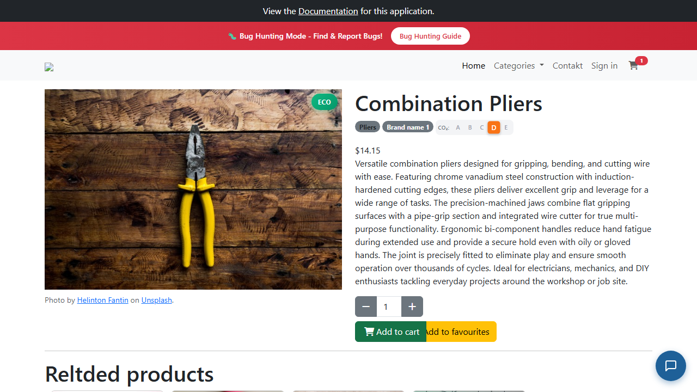
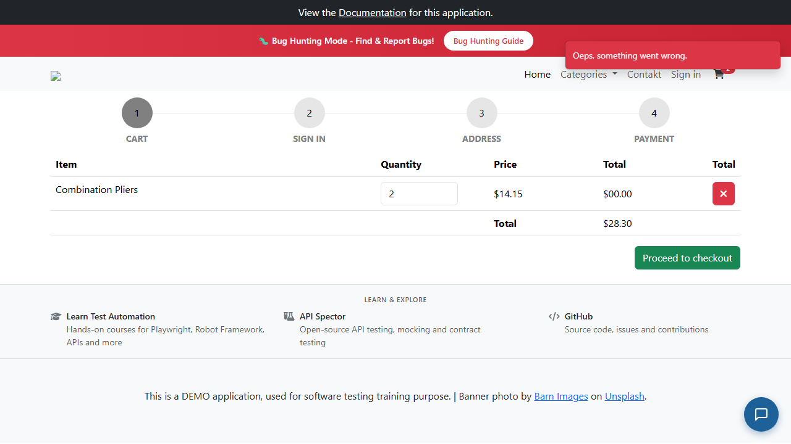
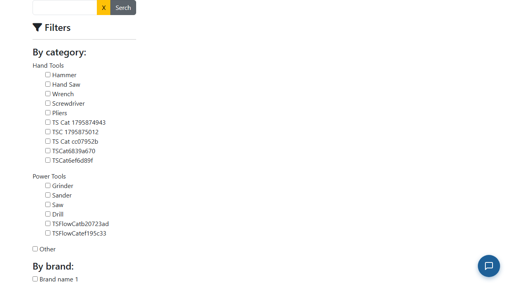
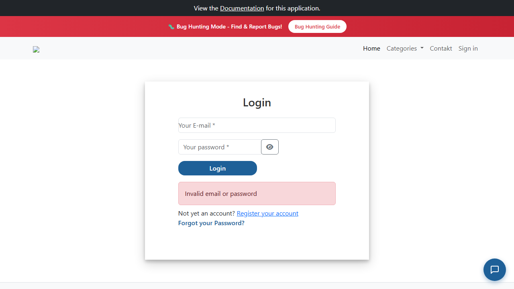
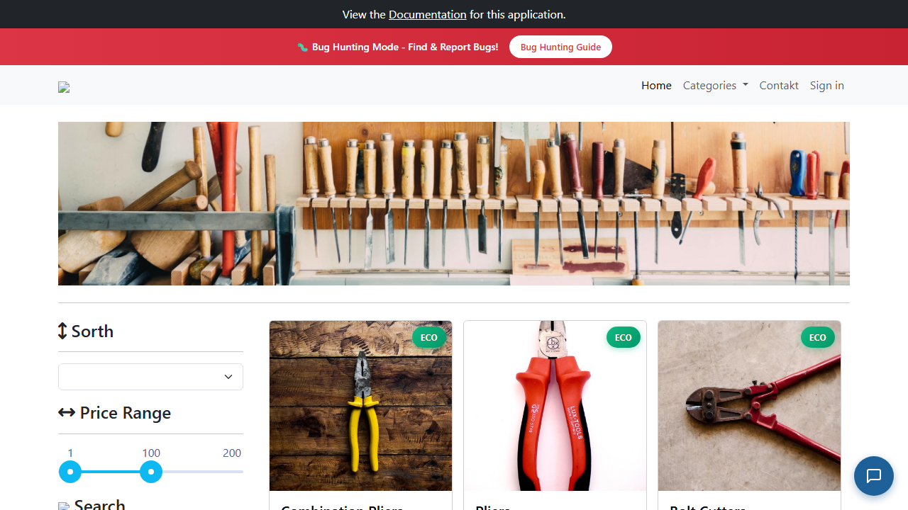

# BUG_REPORT - Toolshop BUGGY

> **Nguyên tắc tính lỗi:** Xanh trên PROD (`https://practicesoftwaretesting.com`), đỏ trên BUGGY (`https://with-bugs.practicesoftwaretesting.com`), hành vi sai so với nghiệp vụ, có ảnh bằng chứng đính kèm. Nhiều test đỏ vì cùng một lỗi chỉ tính 1 lỗi.

**Lần chạy xác minh cục bộ:**
`BASE_URL=https://with-bugs.practicesoftwaretesting.com API_URL=https://api-with-bugs.practicesoftwaretesting.com ROUTE_PREFIX=/# pytest tests/buoi4 -v --screenshot only-on-failure --tracing retain-on-failure`  
**Kết quả trên PROD:** `7 passed` | **Kết quả trên BUGGY:** `7 failed`

---

## Bảng tóm tắt các lỗi thật (7 lỗi)

| Code | Feature | Title | Severity | Detected by |
|---|---|---|---|---|
| BUG-001 | Product / Cart | Add to cart displays error toast `"Oeps, something went wrong."` | High | `tests/buoi4/test_b4_loose.py::test_b4_a_add_to_cart_shows_a_toast` & `tests/ui/test_smoke.py::test_smoke_product_add_quantity_three_updates_cart_badge` |
| BUG-002 | Shopping Cart | Cart line price displays `$00.00` instead of `unit_price * quantity` | High | `tests/buoi4/test_b4_loose.py::test_b4_b_cart_has_a_total` & `tests/ui/test_ui_features.py::test_cart_line_price_equals_unit_price_times_quantity` |
| BUG-003 | Product Search | Empty search result does not display `"There are no products found."` | Medium | `tests/buoi4/test_b4_loose.py::test_b4_c_search_without_results_counts_zero` & `tests/ui/test_ui_features.py::test_search_unknown_keyword_shows_no_results` |
| BUG-004 | Authentication | Empty login form submission does not show required validation errors | Medium | `tests/buoi4/test_b4_loose.py::test_b4_d_login_empty_form_stays_on_login` & `tests/ui/test_ui_features.py::test_login_empty_form_shows_required_errors` |
| BUG-005 | Navigation / Header | Header link and Search button have typos (`Contakt`, `Serch`) | Low | `tests/buoi4/test_b4_loose.py::test_b4_e_header_has_contact_and_search` |
| BUG-006 | Home / Pagination | Pagination controls (`ul.pagination`) are missing on home page | High | `tests/buoi4/test_b4_loose.py::test_b4_f_home_lists_products` |
| BUG-007 | Search API | `GET /products/search?q=wrench` returns unrelated products | High | `tests/buoi4/test_b4_loose.py::test_b4_g_search_api_finds_wrench` & `tests/api/test_products_api.py::test_products_search_api_returns_only_matching_names[wrench]` |

---

## Chi tiết từng lỗi

### BUG-001 - Add to cart displays error toast `"Oeps, something went wrong."`
- **Feature:** Product Detail / Add to Cart
- **Environment:** `https://with-bugs.practicesoftwaretesting.com` (xanh trên PROD)
- **Steps to reproduce:**
  1. Mở trang chủ `https://with-bugs.practicesoftwaretesting.com/#/`.
  2. Chọn sản phẩm **Combination Pliers**.
  3. Bấm nút **Add to cart**.
- **Expected:** Toast thông báo thành công chứa nội dung `"Product added to shopping cart"`.
- **Actual:** Toast màu đỏ (`bg-danger`) hiện nội dung `"Oeps, something went wrong."`.
- **Detected by:** `tests/buoi4/test_b4_loose.py::test_b4_a_add_to_cart_shows_a_toast`
- **Evidence:**  (trace trong artifact `report-buggy`)
- **Notes:** Cũng làm đỏ `tests/ui/test_smoke.py::test_smoke_product_add_quantity_three_updates_cart_badge`.

---

### BUG-002 - Cart line price displays `$00.00` instead of `unit_price * quantity`
- **Feature:** Shopping Cart
- **Environment:** `https://with-bugs.practicesoftwaretesting.com` (xanh trên PROD)
- **Steps to reproduce:**
  1. Mở trang chủ, chọn sản phẩm **Combination Pliers** (đơn giá `$14.15`).
  2. Nhập số lượng `2` và bấm **Add to cart**.
  3. Mở trang giỏ hàng (`/#/checkout`).
- **Expected:** Cột Line Price hiển thị `$28.30` (`14.15 * 2`).
- **Actual:** Cột Line Price hiển thị `$00.00` dù Cart Total vẫn là `$28.30`.
- **Detected by:** `tests/buoi4/test_b4_loose.py::test_b4_b_cart_has_a_total`
- **Evidence:**  (trace trong artifact `report-buggy`)
- **Notes:** Cũng làm đỏ `tests/ui/test_ui_features.py::test_cart_line_price_equals_unit_price_times_quantity`.

---

### BUG-003 - Empty search result does not display `"There are no products found."`
- **Feature:** Product Search
- **Environment:** `https://with-bugs.practicesoftwaretesting.com` (xanh trên PROD)
- **Steps to reproduce:**
  1. Mở trang chủ `https://with-bugs.practicesoftwaretesting.com/#/`.
  2. Nhập từ khóa không tồn tại `zzz-no-such-tool` vào ô tìm kiếm.
  3. Bấm nút tìm kiếm (**Serch**).
- **Expected:** Giao diện hiển thị phần tử `[data-test="no-results"]` với nội dung `"There are no products found."` và 0 thẻ sản phẩm.
- **Actual:** Không có phần tử `[data-test="no-results"]` trên DOM, chỉ hiện dòng `"0 products found for 'zzz-no-such-tool'"`.
- **Detected by:** `tests/buoi4/test_b4_loose.py::test_b4_c_search_without_results_counts_zero`
- **Evidence:**  (trace trong artifact `report-buggy`)
- **Notes:** Cũng làm đỏ `tests/ui/test_ui_features.py::test_search_unknown_keyword_shows_no_results`.

---

### BUG-004 - Empty login form submission does not show required validation errors
- **Feature:** Authentication / Login
- **Environment:** `https://with-bugs.practicesoftwaretesting.com` (xanh trên PROD)
- **Steps to reproduce:**
  1. Mở trang đăng nhập `/#/auth/login`.
  2. Để trống cả hai ô Email và Password.
  3. Bấm nút **Login**.
- **Expected:** Hiển thị thông báo lỗi bắt buộc `"Email is required"` và `"Password is required"`.
- **Actual:** Không hiển thị các phần tử thông báo lỗi `[data-test="email-error"]` và `[data-test="password-error"]`.
- **Detected by:** `tests/buoi4/test_b4_loose.py::test_b4_d_login_empty_form_stays_on_login`
- **Evidence:**  (trace trong artifact `report-buggy`)
- **Notes:** Cũng làm đỏ `tests/ui/test_ui_features.py::test_login_empty_form_shows_required_errors`.

---

### BUG-005 - Header navigation and Search button have typos (`Contakt`, `Serch`)
- **Feature:** Global Header / Navigation
- **Environment:** `https://with-bugs.practicesoftwaretesting.com` (xanh trên PROD)
- **Steps to reproduce:**
  1. Mở trang chủ `https://with-bugs.practicesoftwaretesting.com/#/`.
  2. Quan sát chữ trên thanh menu điều hướng và nút tìm kiếm.
- **Expected:** Liên kết liên hệ ghi `"Contact"` và nút tìm kiếm ghi `"Search"`.
- **Actual:** Liên kết liên hệ ghi `"Contakt"` và nút tìm kiếm ghi `"Serch"`.
- **Detected by:** `tests/buoi4/test_b4_loose.py::test_b4_e_header_has_contact_and_search`
- **Evidence:**  (trace trong artifact `report-buggy`)

---

### BUG-006 - Home page pagination controls (`ul.pagination`) are missing
- **Feature:** Home Page / Catalogue Pagination
- **Environment:** `https://with-bugs.practicesoftwaretesting.com` (xanh trên PROD)
- **Steps to reproduce:**
  1. Gọi `GET /products?page=1` thấy hệ thống có `total = 26`, `per_page = 9` (tức phải có 3 trang).
  2. Mở trang chủ `https://with-bugs.practicesoftwaretesting.com/#/`.
  3. Quan sát khu vực phân trang dưới danh sách sản phẩm.
- **Expected:** Hiển thị danh sách nút phân trang `ul.pagination` (page 1, 2, 3...) để người dùng xem hết 26 sản phẩm.
- **Actual:** Phần tử `ul.pagination` không tồn tại trên trang (`count == 0`), người dùng không thể duyệt các trang tiếp theo.
- **Detected by:** `tests/buoi4/test_b4_loose.py::test_b4_f_home_lists_products`
- **Evidence:**  (trace trong artifact `report-buggy`)

---

### BUG-007 - `GET /products/search?q=wrench` API returns unrelated products
- **Feature:** Products Search API
- **Environment:** `https://api-with-bugs.practicesoftwaretesting.com` (xanh trên PROD)
- **Steps to reproduce:**
  1. Gửi request `GET https://api-with-bugs.practicesoftwaretesting.com/products/search?q=wrench`.
  2. Kiểm tra trường `name` của các phần tử trong mảng `data`.
- **Expected:** Mọi sản phẩm trả về đều có tên liên quan / chứa từ khóa `"wrench"`.
- **Actual:** API trả về `['Adjustable Wrench', 'Angled Spanner', 'Phillips Screwdriver', 'Circular Saw']` — chứa các sản phẩm hoàn toàn không phải cờ lê (tua vít, máy cưa).
- **Detected by:** `tests/buoi4/test_b4_loose.py::test_b4_g_search_api_finds_wrench`
- **Evidence:** Response JSON thực tế từ API trong log kiểm thử (cùng lỗi với `tests/api/test_products_api.py::test_products_search_api_returns_only_matching_names[wrench]`).

---

## Phân loại các test đỏ khác trên BUGGY (Không tính là lỗi)

| Loại không tính | Nguyên nhân trên BUGGY | Ví dụ test |
|---|---|---|
| **Khác dữ liệu** | BUGGY có tổng cộng 26 sản phẩm (PROD có 50), một số tên/id sản phẩm hoặc giá khác nhau | Test phụ thuộc dữ liệu cụ thể |
| **Khác môi trường** | Đường dẫn hash `/#/`, API `/products` dùng `GET` kèm query param thay vì `QUERY` | Route regex nếu không hỗ trợ cả hai |
| **Trùng lỗi đã báo cáo** | Nhiều test đỏ vì cùng 1 lỗi gốc (VD: `test_smoke_product_add_quantity_three_updates_cart_badge` đỏ do cùng BUG-001) | Đã gom vào mục **Notes** của BUG-001 -> BUG-004 |
